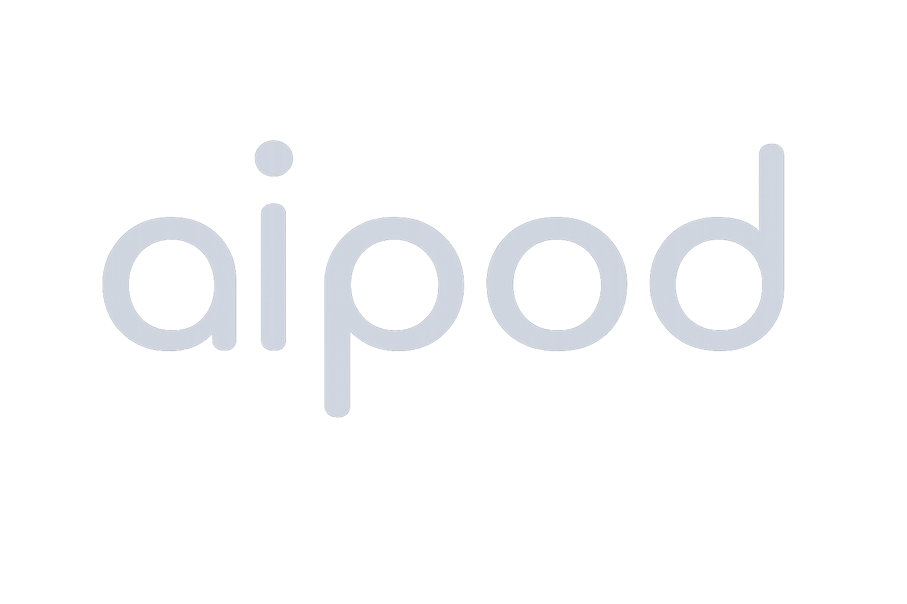
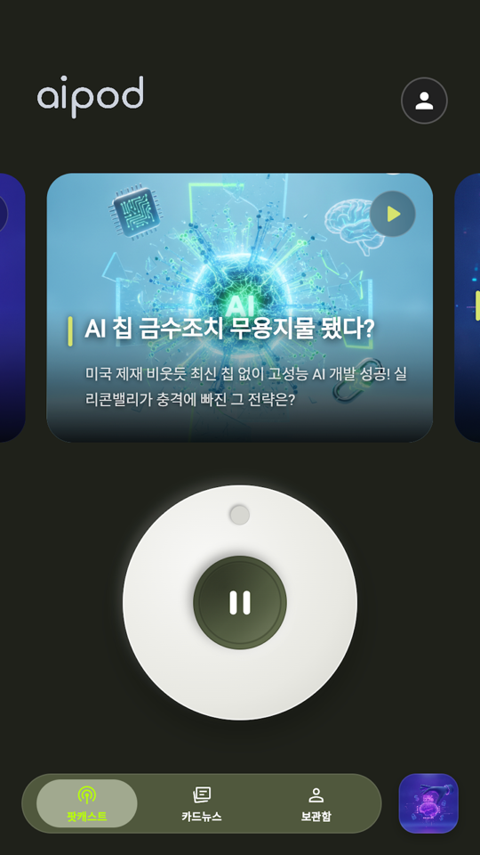
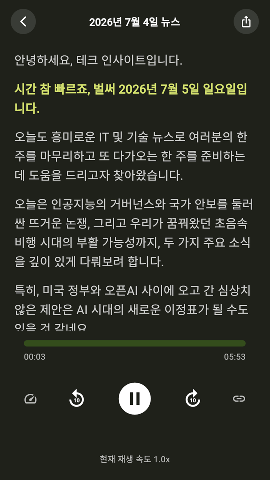
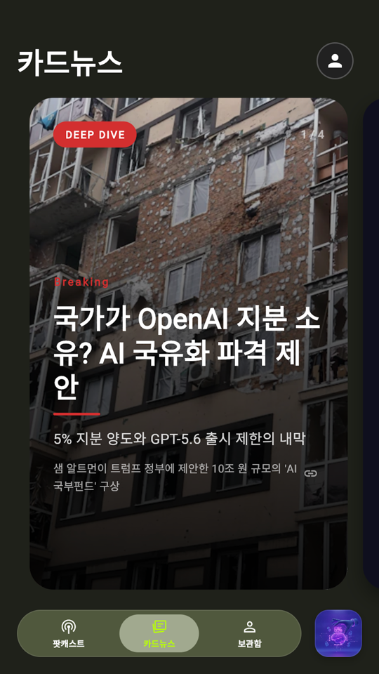
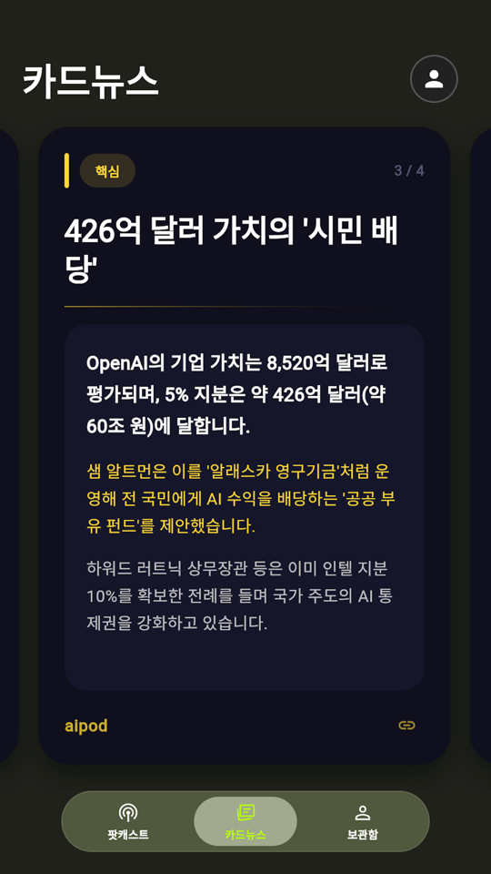
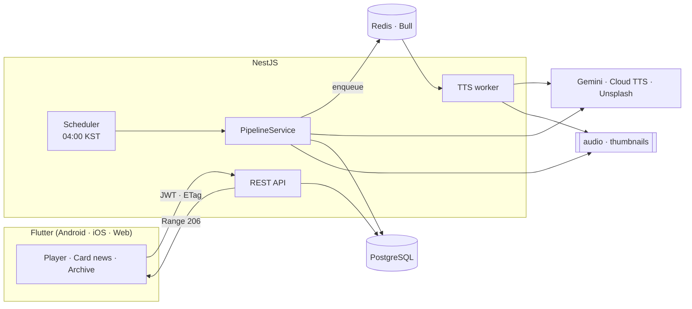

<p align="center">
  
</p>

<h1 align="center">AiPod</h1>

<p align="center">
  <b>해외 IT 뉴스를 매일 아침, 한국어 팟캐스트와 카드뉴스로.</b>
</p>

AiPod는 매일 KST 04:00에 그날의 주요 테크 기사를 찾아 약 10분 분량을 목표로 한 한국어 오디오 브리핑과 4장 구성의 딥다이브 카드뉴스를 만듭니다.
기사 수집부터 대본, 음성 합성, 발행까지 사람이 개입하지 않습니다.

<table>
  <tr>
    <td align="center"></td>
    <td align="center"></td>
    <td align="center"></td>
    <td align="center"></td>
  </tr>
  <tr>
    <td align="center">클릭휠로 에피소드 탐색</td>
    <td align="center">재생 위치를 따라가는 자막</td>
    <td align="center">오늘의 딥다이브</td>
    <td align="center">검색으로 보강한 본문</td>
  </tr>
</table>

---

## Why

**Problem** — 중요한 IT 뉴스는 대부분 영어이고, 여러 매체에 흩어져 있습니다.

**기존 방식의 한계** — 뉴스레터와 번역 요약도 결국 시간을 내서 *읽어야* 합니다. 사람이 매일 큐레이션하는 방식은 꾸준히 유지하기 어렵습니다.

**AiPod의 접근** — 뉴스를 출근길에 *듣는* 형태로 바꾸고, 수집 → 요약 → 음성 → 발행을 매일 스스로 도는 파이프라인으로 만들었습니다. 모든 에피소드에는 원문 출처가 남습니다.

---

## What it does

- **매일 아침 새 에피소드** — 그날의 기사 5~7개(목표)를 골라, 한 명의 내레이터가 전하는 브리핑 대본으로 만듭니다.
- **클릭휠로 넘기기** — iPod 클릭휠을 닮은 다이얼을 돌려 에피소드를 넘기고, 가운데를 눌러 재생합니다.
- **들으면서 읽기** — 재생 위치에 맞춰 대본 자막이 따라갑니다. 백그라운드·잠금 화면 재생을 지원합니다.
- **한 주제를 깊게** — 그날 가장 영향력 있는 주제 하나를 골라, Google 검색으로 최신 수치와 맥락을 보강한 4장 카드뉴스로 정리합니다.
- **출처 그대로** — 에피소드마다 원문 기사의 제목·매체·링크를 보여주고 바로 열 수 있습니다.
- **내 계정** — Google 로그인, 보관함, 테마 설정, 계정 삭제.

---

## How it works



하루 한 번 파이프라인이 다음 단계를 순서대로 실행합니다.

| 단계 | 하는 일 | 실패하면 |
|---|---|---|
| 1. 기사 수집 | Gemini Google Search grounding으로 기사 5~7개(목표)의 제목·요약·URL 수집 | API 오류 시 run 실패, 기사가 `MIN_ARTICLES`(기본 3) 미만이면 skip |
| 2. 대본 생성 | 토픽 전환 마커가 들어간 내레이션 대본 생성 | 60초 timeout, 2회 시도 후 run 실패 |
| 3. 저장 | 에피소드와 출처 저장 | run 실패 |
| 4. 헤드라인 · 썸네일 | 헤드라인과 부제, AI 썸네일 이미지 생성 | 경고만 남기고 계속 |
| 5. 카드뉴스 | 딥다이브 카드 4장을 JSON으로 생성, 표지 이미지 검색 | 경고만 남기고 계속 |
| 6. TTS | Bull 큐에서 비동기 합성 → MP3 + `cues.json` | 경고, 실패 시점에 run에 기록 |
| 7. 알림 | Discord로 성공 / 경고 결과 전송 (skip·실패 run은 알림 없음) | 경고만 남기고 계속 |

---

## Engineering Highlights

### 1. 대본만 살아남으면 에피소드는 나간다

외부 API를 여러 차례 호출하는 파이프라인에서, 하나의 실패가 그날의 발행 전체를 막으면 안 됩니다.

- 핵심 산출물은 **대본**입니다. 대본 생성까지 실패하면 run이 실패하고, 그 뒤 단계는 각자 실패를 *경고*로 수집한 채 계속 진행합니다.
- 실패한 단계만 다시 실행합니다 — `POST /pipeline/retry-cardnews/:id`, `POST /pipeline/retry-tts/:id`.
- 단계별 상태를 `pipeline_runs` / `pipeline_run_steps`에 저장합니다. 파이프라인이 등록한 TTS job은 큐에서 뒤늦게 실패해도 같은 run에 기록되므로, 컨테이너가 재생성돼도 어느 단계가 왜 실패했는지 남습니다.
- 같은 날 두 번 발행하지 않습니다. 스케줄러는 실행 중이면 건너뛰고, 오늘 에피소드가 이미 있으면 skip합니다(`?force=true`로 우회).

### 2. 10분짜리 대본을 음성과 자막으로

10분 대본은 TTS 한 번의 요청에 들어가지 않고, 앱은 문장 단위 자막 타이밍이 필요합니다.

- SSML이 4,000 bytes를 넘으면 `---TOPIC_CHANGE---` 마커 기준으로 나누고, 그래도 크면 대사 줄 단위로 다시 나눕니다. 가능한 한 토픽 경계에서 자릅니다.
- 청크마다 **실제 오디오 길이**(ffprobe 또는 PCM 샘플 수)를 측정하고, 그 안에서 문장별 시간을 글자 수·문장부호 가중치로 배분합니다. 청크 안의 문장 사이 300ms·토픽 전환 800ms 쉼과 청크 사이 10ms crossfade도 cue에 반영합니다.
- 청크를 10ms crossfade로 이어 붙인 뒤, ffmpeg로 loudnorm을 적용하고 64kbps 모노 MP3로 인코딩합니다.
- **Trade-off** — cue는 단어 단위 timepoint가 아닌 추정값입니다. 대신 청크마다 실측 길이로 다시 맞추므로 오차가 에피소드 끝까지 누적되지 않습니다.

### 3. 카드뉴스는 이미지가 아니라 데이터로

카드뉴스를 서버에서 PNG로 굽는 대신, 카드 내용을 JSON으로 저장하고 앱이 직접 그립니다.

- 앱 테마와 화면 크기에 맞춰 렌더링되고, 일일 파이프라인에 headless Chromium 렌더링 단계가 필요 없습니다.
- 팟캐스트 대본은 **주제 선택에만** 쓰고, 카드 본문은 Google Search grounding 결과로 씁니다. 같은 내용을 반복하지 않고 새 정보를 더하기 위해서입니다. 응답 JSON 파싱에 실패하면 grounding 없는 생성으로 대체합니다.
- 외부 이미지는 표지 1장만 Unsplash에서 가져오고, URL 파라미터로 600px WebP를 요청해 전송량을 줄입니다.

### 4. 같은 데이터를 두 번 받지 않는다

콘텐츠는 하루에 한 번 바뀌지만, 앱은 훨씬 자주 열립니다. 변하지 않은 데이터는 다시 받지 않도록 계층별로 나눴습니다.

| 대상 | 방법 |
|---|---|
| API 응답 | Dio 인터셉터가 저장된 ETag를 `If-None-Match`로 보내고, `304`면 로컬에 저장한 바디로 응답합니다. 재생성 직후 바로 바뀌어야 하는 `/card-news`는 제외합니다. |
| 이미지 | `CachedNetworkImage` + 전용 CacheManager (7일, 최대 300개) |
| 오디오 | 서버가 Range 요청에 `206`으로 응답해, 탐색(seek) 시 필요한 구간만 전송합니다. |
| 텍스트 | 1KB 이상 응답은 gzip 압축 |

### 5. Refresh token rotation과 동시 요청

- 서버에서 Google ID token(또는 access token)을 검증한 뒤 자체 JWT(access 1시간)와 refresh token을 발급합니다. refresh token은 bcrypt 해시로만 저장하고, 쓸 때마다 폐기 후 재발급합니다(rotation).
- rotation 환경에서 두 요청이 동시에 refresh하면, 늦은 쪽은 이미 폐기된 토큰을 보내게 됩니다. 그래서 앱은 인증 요청 전에 만료 60초 이내인 토큰을 미리 갱신하고, 동시에 일어난 갱신은 **하나의 요청을 공유**합니다.
- 요청 중 갱신이 일시적인 네트워크 오류로 실패하면 세션을 유지하고, 서버가 refresh를 거부할 때만 로그아웃합니다.
- 로그인·refresh·로그아웃·계정 삭제는 `auth_audit_logs`에 남깁니다. IP는 원문 없이 secret을 섞은 SHA-256 해시로만 저장하고, 계정 삭제 시 로그의 `userId`를 익명화합니다.

### 6. 구조를 지키는 CI

- **Architecture fitness check** — NestJS 모듈 import 그래프에서 순환 의존과 `common` → feature 역참조를 검사합니다. 새 위반이 생기면 CI를 실패시키고, 의도적으로 남기는 위반은 baseline으로 관리합니다 (현재 0건).
- **Backend CD** — `main` 머지 → commit SHA 태그로 Docker 이미지 빌드 → 서버 배포 → health check. 이미지 pull·컨테이너 기동이나 health check가 실패하면 직전 이미지로 롤백합니다.
- **Android CD** — Play 비공개 테스트(alpha) 트랙에 업로드합니다 (검토 제출은 수동). `versionCode`는 Play의 모든 트랙에서 가장 높은 값에 1을 더해 충돌을 막습니다.

---

## Tech Stack

| 영역 | 기술 | 역할 |
|---|---|---|
| App | Flutter, just_audio, Dio, cached_network_image | 하나의 코드로 Android · iOS · Web, 백그라운드 재생 |
| API | NestJS 11, TypeORM | 파이프라인 단계를 모듈 단위로 분리 |
| Data | PostgreSQL 15 | 에피소드, 사용자, 실행 이력, 분석 이벤트 |
| Queue | Redis 7, Bull | 수 분 걸리는 TTS를 요청 경로에서 분리 |
| AI | Gemini (Google Search grounding), Google Cloud TTS Chirp 3 HD | 기사 수집·대본·카드뉴스, 한국어 음성 |
| Media | ffmpeg, Unsplash API | 오디오 인코딩, 카드뉴스 표지 이미지 |
| Infra | Docker Compose, GitHub Actions, Docker Hub | 배포와 CI/CD |

---

## Getting Started

**Requirements** — Node.js 20+, Docker, Flutter, ffmpeg (오디오 MP3 인코딩)

### Backend

```bash
cd backend
cp .env.example .env
docker compose up -d     # PostgreSQL 5432, Redis 6379
npm install
npm run start:dev        # http://localhost:3000
```

`.env`에 다음 키를 추가하거나 채웁니다. `MINDLOGIC_API_KEY`, `GOOGLE_CLOUD_TTS_API_KEY`, `UNSPLASH_ACCESS_KEY`는 `.env.example`에 없으므로 직접 추가합니다.

| 키 | 용도 |
|---|---|
| `GOOGLE_AI_STUDIO_API_KEY` | 기사 수집, 카드뉴스 grounding |
| `MINDLOGIC_API_KEY` | 대본 · 헤드라인 · 썸네일 생성 (Gemini 게이트웨이) |
| `GOOGLE_CLOUD_TTS_API_KEY` | 음성 합성 |
| `UNSPLASH_ACCESS_KEY` | 카드뉴스 표지 이미지 |
| `GOOGLE_CLIENT_ID`, `JWT_ACCESS_SECRET`, `JWT_REFRESH_SECRET` | 로그인 |

파이프라인은 매일 04:00에 자동으로 실행됩니다. 바로 실행하려면 `users.role`이 `ADMIN`인 계정의 access token으로 호출합니다.

```bash
curl -X POST http://localhost:3000/pipeline/run -H "Authorization: Bearer <ADMIN_ACCESS_TOKEN>"
```

### App

```bash
cd frontend
flutter pub get
flutter run --dart-define=ENV=dev \
  --dart-define=DEV_HOST=<로컬 IP> \
  --dart-define=GOOGLE_CLIENT_ID=<Google OAuth 웹 클라이언트 ID>
```

Android 에뮬레이터에서는 `DEV_HOST=10.0.2.2`를 사용합니다. `DEV_HOST`를 지정하지 않거나 Web으로 실행하면 로컬 서버가 아닌 원격 기본 서버(`lib/core/app_config.dart`)에 연결됩니다.

---

## More

```
aipod/
├── backend/    NestJS API, 일일 파이프라인, TTS 워커
│   └── src/modules/   pipeline · grounding · ai-processor · card-news · tts · auth · analytics …
├── frontend/   Flutter 앱
│   └── lib/features/  podcast · card_news · auth · splash
└── docs/       GitHub Pages (서비스 소개, 문의)
```

- [backend/README.md](backend/README.md) — API 엔드포인트, 환경 변수 전체 목록, 분석 API
- [CONTRIBUTING.md](CONTRIBUTING.md) — 브랜치 · 커밋 규칙, 검증 명령, CI/CD 설정, 운영 로그
